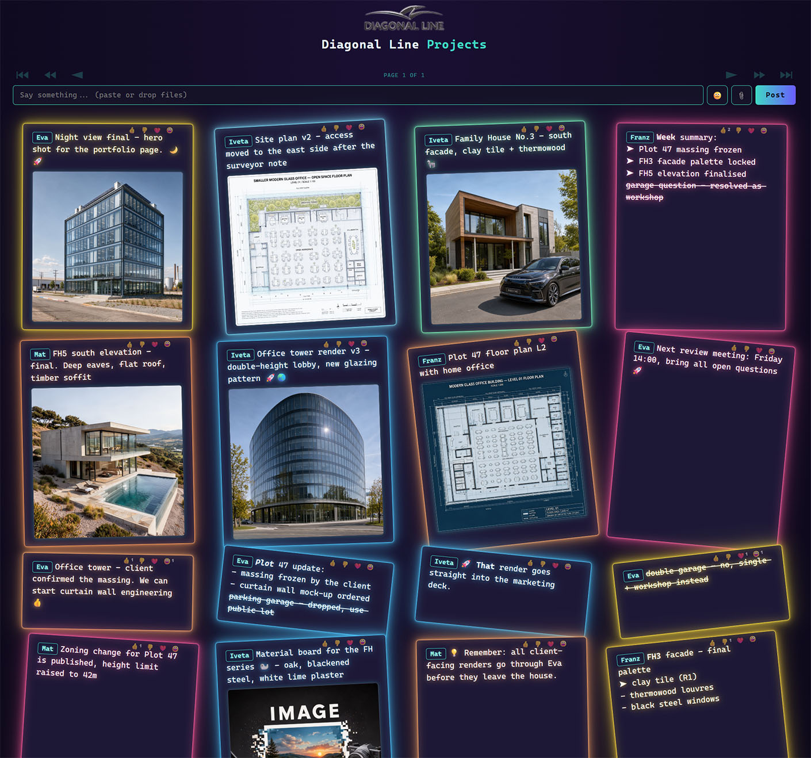
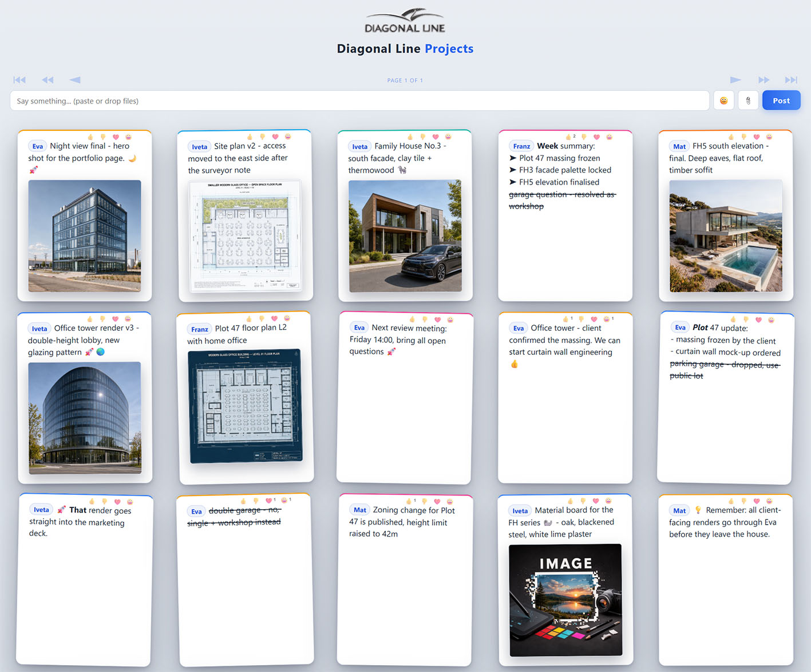

# Tiltboard

A tiny single-file web app (Python stdlib only, no dependencies). Type text in the box at the top and click **Post** — it appears as a tilted shape below the composer. Newest posts sit just under the text box; older ones stack toward the bottom of the page. Each card gets a random tilt angle and pastel color.

## Why Tiltboard exists

<p align="center"></p>
<p align="center"></p>

A file share, a chat and a bulletin board on one page - with none of the usual ceremony:

- **Login only when you want one, never a database** - open boards stay exactly that: open the page and post. Set `pass_full_access` (optionally `pass_read_only`) in config.json to put a themed login screen in front of everything, with an optional read-only mode for visitors who just browse and react; either way your *Name* badge, style and rows/columns live in browser cookies.
- **Runs as a plain .exe** - `tiltboard.exe` needs nothing but Windows x64: double-click and it serves itself, reading config.json, chat.txt and styles/ right next to it.
- **The whole history is one text file** - every post is one line in `chat.txt`, human-readable, diff-able and portable; restart the server and everything comes back.
- **Share big files without thinking about it** - drag & drop or paste small ones straight onto the box; for anything over 256 MB attach with the paperclip and watch progress fill the text box while ~8 MB slices stream in the background.
- **Find any old post instantly** - the search bar filters *all* of chat.txt live as you type, including `u:name`, `f:filename` and plain-text queries.
- **React on any post** - every card carries four always-visible rating icons (👍 👎 ❤ 😀) left of the delete cross; one vote per visitor is remembered in localStorage until the cache is cleared, and counts live in chat.txt itself (`::a:b:c:d` tail on the line), so they survive restarts and are visible to everyone.
- **Easy to make yours** - drop a `header.html` into the app folder for your own banner (logos, company name), pick one of nine built-in styles, or bring your own.

Posted texts persist to `chat.txt` (one line per tilt, newest last) and are restored on restart — the file grows without bound; the board simply pages through it in row-major chunks of *Rows* × *Columns* cards. Tilt angle and color are re-rolled randomly each time.

## Formatting

A small escape set works inside the message box; everything you type is stored literally (one line per tilt) and interpreted only when rendering, so it also survives restarts:

| You type                 | You get                                                                                             |
| ------------------------ | --------------------------------------------------------------------------------------------------- |
| `\n`                     | a new line inside the same tilt                                                                     |
| `\bword`                 | **bold** — formats the next non-space token (`\bbold rest of text`)                                 |
| `\uword`                 | <u>underlined</u> word (same rule: the very next token)                                             |
| `\iword`                 | *italic* word (same rule)                                                                           |
| stacked, e.g. `\b\itext` | all prefixes stack on that one word (**bold+italic**), in written order; `\b\btext` = single bold   |
| `` `snippet` ``          | **code** in backticks — literal text; only `\n` still breaks a line (format escapes ignored inside) |
| `~~text~~`               | <s>struck-through</s> span between paired tildes (see **Strikethrough**)                            |
| a plain URL              | clickable link — opens in a new tab (`http://`, `https://`, `ftp://`; see **Links**)                |

Notes:
- **Name badge** - when *Name* in the settings box is not the default `User`, every post starts with `Name:`. On the board that prefix renders inside a small colored badge and the colon itself disappears; chat.txt still stores the plain `name: text` line, so nothing changes for readers of the file.
- A formatting escape applies to exactly one token — the run of characters up to the next space **or the start of another recognized escape**. `\bHello, world!` bolds only `Hello,`, and `\uwork\n\bsee` underlines `work` only, breaks the line, then bolds `see` (a chained escape is never swallowed into the previous word). Type each word separately if you want more.
  - A backslash that does not start a recognized escape stays literal inside its token: `\uLet'\\s` still underlines the whole `Let'\\s`; only a real `\\n`, `\\b`, `\\i` or `\\u` *inside* the word ends it and starts working. Plain text outside of a formatting escape is never affected — Windows paths such as `C:\new\file` keep every backslash.
- Pasted multi-line text arrives exactly as copied - all lines stay visible in the box (it grows to fit them), and on posting every line break becomes a `\n` escape, so chat.txt stays one line per tilt.
- Pasted `<b>…</b>` / `<i>…</i>` / `<u>…</u>` tag pairs are converted at paste time to stacked per-word prefixes (`<b>Hello world</b>` → `\bHello \bworld`, nested tags stack in written order), and pasted `<s>…</s>` / `<strike>…</strike>` / `<del>…</del>` pairs become a single `~~…~~` span. Tags you type by hand stay literal, as always.
- The box starts at exactly **one line of text** (with its icons) and grows dynamically whenever a new line appears - typed or pasted. After posting the page reloads and the box is back to its one-line size.
- **Enter posts the message, Shift+Enter inserts a new line** - handy for multi-line tilts without leaving the box.
- An escape with nothing after it (e.g. a trailing `\b`), an unmatched backtick, and an unclosed `~~` (no closing pair) are all shown literally, not treated as markup — unless the escape is directly followed by a paired `~~span~~`, in which case it applies to the whole span (`\b~~text~~` → bold *and* struck through).
- **Strikethrough** - `~~text~~` strikes everything between the paired tildes; per-word escapes (`\b`, `\u`, `\i`) still work *inside* the span (each formats its own word), and stacked prefixes written before the opening `~~` wrap the whole span (`\b~~text~~` → bold *and* struck through). An unmatched `~~` keeps both tildes as-is.
- **Links** - a URL written as its own word is auto-linked and opens in a new tab. The link runs from the protocol marker to just before the next space, backslash or end-of-line (whichever comes first) — no trimming, so `see https://example.com.` still includes that trailing period, while an escape glued right after it (`http://my_domain\n…`) is honoured as a line break instead of being swallowed into the link. Inside `` `code` `` spans URLs stay literal, and an escape glued directly in front of a URL (`\bhttp://…`) bolds it as plain text — keep a space before the URL.
- All other characters render exactly as typed; anything HTML-like (`<script>`, quotes, …) is escaped automatically — the escapes above are the only way to influence rendering.

## Attachments

A post can carry **one file**: click the 📎 icon next to the emoji button, drag a file onto the box, or paste an image. The pending file appears as a paperclip inside the text box (top-right corner when it is multi-line) without changing its size. Hovering the clip shows the filename and makes it zoom up with a glow in the current theme's color; a small ✕ fades in beside it while hovering — clicking that removes the file before posting. Attaching a second file replaces the first.

Tilts can be removed again: hovering any card reveals a small **✕** in its upper-right corner. Clicking it opens a confirm dialog (Delete / Cancel) warning that an existing source file is deleted from disk as well — confirming removes the tilt's line from `chat.txt`, physically deletes the attachment if still present, and reloads the page without that tilt.

On posting, images render as an inline preview inside the tilt (a download icon appears at its bottom-right corner on hover); any other file becomes a labeled download link. Files land in the data folder (`data_folder`), and `chat.txt` stores only the text plus an absolute link into that folder (a forward-slashed `file:///…` path, spaces %20-escaped) — so tilts keep working across restarts as long as the files stay where they were.

Uploads are routed by how they arrive: files **dragged onto the box or pasted** go out as one multipart request (that method proved reliable even for multi-GB drops — 4 GB verified), while anything attached through the 📎 paperclip always uses a chunked protocol — name reservation, ~8 MB slices streamed one after another, then commit, each step retried automatically. A drop larger than **256 MB** gets a hint to attach it via the paperclip instead of being sent directly.

While the paperclip path is uploading, progress renders *inside* the text box: a semi-transparent blue fill grows across it (typed text stays readable underneath) and a small label pill in its top-right corner shows `filename - x.x MB of y.y MB`, refreshing after every slice. The overlay tracks the box's real height, so even multi-line boxes never show progress spilling past their border.

## Search

The magnifier icon (left of the settings gear) toggles a search bar that live-filters **all** of chat.txt, not just the visible page. At least three characters activate it; matching tilts render exactly like normal posts and the pagers hide while filtering — closing the bar brings back your usual page view.

| You type            | It matches                                          |
| ------------------- | --------------------------------------------------- |
| `hello`             | any line containing *hello* (case-insensitive)      |
| `u:john` / `n:john` | only tilts posted by **john**                       |
| `f:my_pic.jpg`      | tilts whose attached file name contains it          |
| `c:text`            | message bodies only — the `name:` prefix is ignored |

Tokens separated by spaces are AND-ed, e.g. `u:john f:report.pdf` finds John's posts with a report.pdf attachment.

## Sync (server to server)

Tiltboard can mirror another Tiltboard so two locations always hold the same board - one machine runs as the **active** side and keeps the other in step, without any database or external sync tool. Both boards keep their plain `chat.txt` + data folder; nothing about a single-board setup changes unless you opt in.

| Key                | Meaning                                                                               | Fallback when missing |
| ------------------ | ------------------------------------------------------------------------------------- | --------------------- |
| `server_1_sync`    | the passive board to mirror, e.g. `http://10.1.1.2:8000`; set only on the active side | sync off              |
| `sync_token`       | shared secret for the sync handshake; must be **identical on both machines**          | no token gate         |
| `server_2_sync`    | reserved slot for a second remote (parsed but not used in this release)               | -                     |
| `pass_full_access` | password granting full access (post, delete, rate); empty/unset = no login anywhere   | auth off              |
| `pass_read_only`   | optional second password: read, download and rate only; posting/deleting is locked    | ignored alone         |

One board runs the active side and keeps the other passive: set `server_1_sync` only where the mirror is wanted. A passive board is simply a plain Tiltboard without `server_N_sync` in its config.json - it never polls anything and only accepts sync calls that carry the right token. Configuring both sides to point at each other would create two active mirrors fighting over who owns what, so do not do this.

The active side keeps a background worker ticking roughly every 2 seconds (woken immediately by local events). Each tick it first forwards any still-unconfirmed local actions - posts, deletes and ratings are replayed on the passive board with plain HTTP POSTs carrying the shared token, retried at growing intervals up to ~30 s before they are dropped - then asks the passive side for a single handshake (`/sync/state`) that returns its whole line map and data file list in one request.

From the difference between both sides it reconciles chat.txt and the data folder:

- new remote lines are appended locally, missing ones removed,
- a **conflict** - the same tilt ID holding different text on both boards - resolves to **remote-wins**: your local copy is dropped and the passive board's version takes its place. No merging is attempted.
- files that exist on the passive side but not locally are downloaded into the data folder (up to 3 at a time) using the same resumable staging as `slow_upload` - a dot-prefixed `.part` file plus an offset note next to it, an atomic rename once every byte matches the remote size, and ~30 s retries when the network drops. A local file somebody deleted by hand is simply fetched back on the next tick.

Every chat.txt line carries a stable short ID at its very end so both sides can match lines without trusting text equality (plain boards never see it). When sync first switches on, existing lines get IDs once and for all - the backfill is idempotent, nothing is re-stamped. While files are mid-download they stay invisible: dot-prefixed staging names never reach listings or downloads, only a log line tracks their progress.

Security note: Tiltboard has no login **by default** - authentication switches on only when `pass_full_access` is set in config.json (an optional `pass_read_only` adds a browse-and-react tier, see [Configuration](#configuration)). With it off everything behaves exactly as before. With it on, `/post`, `/delete` and `/rate` require the signed role cookie (`/login` issues it), unauthenticated clients get 401 JSON plus a themed login screen instead of the board, and a read-only visitor who tries to post or delete gets a distinct 403 that renders as locked controls rather than an error toast. The token keeps guarding the sync handshake only - `/sync/state` answers 401 when it is configured and does not match; keep both tokens identical and keep the passive side reachable only from trusted networks.

## Run

There are two ways to run the server. Both read **host and port from config.json only** - there is no command-line argument for them (change `"port"` in config.json instead).

### 1. Python script (development / any OS)

Python 3.10+ is all you need - the app uses only the standard library, so nothing to `pip install`:

```
python app.py            # serves http://localhost:8000 per config.json
```

### 2. Standalone Windows x64 executable (no Python on target PC)

Every GitHub Release (this one included) publishes a ready-to-run **tiltboard.exe** as a download asset - grab it from the Releases page and just run it:

```
tiltboard.exe            # same behaviour, finds its files next to itself
```

to rebuild it yourself you need one-time build tooling on any Windows x64 machine with Python installed:

```
pip install pyinstaller
python -m PyInstaller --onefile app.py    # writes dist\app.exe (rename it to tiltboard.exe)
```

The exe must live **next to** config.json, chat.txt and styles/ (that is where it looks for them); a `data` folder or your configured data_folder then works exactly as with the script. Both run modes share the same files - you can switch between them freely.

Then open `http://localhost:8000` in a browser — the UI is plain HTML/CSS/vanilla JS with no external libraries, so any modern evergreen browser works; verified fine on LM Studio's built-in app browser, Opera and Microsoft Edge. Stop with Ctrl+C (texts are kept in `chat.txt`). The app was developed and tested on Python 3.15; the minimum requirement stays 3.10.

Both run modes also write an application log to **tiltboard.log** next to the app: startup info, one INFO line per page open showing the visitor's address plus whatever name/style/cols/rows that browser has stored in its cookies, each posted and deleted tilt as INFO lines, and every failed HTTP request (404 etc.) as a WARNING line. Rotation depends on `"debug"`: standard mode rotates at 1 MB keeping three backups (`tiltboard.log.1-3`); with extended logging on it grows to 10 MB before rotating and keeps ten backups named `tiltboard.debug.log.0-9` (`.0` = newest) that are never deleted automatically. Switching back off while an over-1 MB log is still there saves it once as `tiltboard.log.bak` before starting fresh.

## Configuration

`config.json` next to `app.py` (restart required after changes):

| Key                | Meaning                                                                                                                | Fallback when missing or invalid |
| ------------------ | ---------------------------------------------------------------------------------------------------------------------- | -------------------------------- |
| `host`             | bind address; `0.0.0.0` = reachable across the network                                                                 | `0.0.0.0`                        |
| `port`             | HTTP port                                                                                                              | `8000`                           |
| `data_folder`      | uploads + `chat.txt`; empty = auto-created `./data`, relative → from app dir, absolute → as-is                         | `<app>/data`                     |
| `style`            | theme name — any file in `styles/`; default when no visitor preference (cookie) exists                                 | `classic`                        |
| `rows`             | card **rows** filling one board page; 1–1000                                                                           | `35`                             |
| `columns`          | cards **side by side** in each row; 1–100                                                                              | `1`                              |
| `slow_upload`      | slow-network upload switch; paperclip uploads slice ~256 kB, failed chunks retry every ~30 s                           | `0`                              |
| `debug`            | extended logging switch; `1` logs every action with its parameters and chat.txt line indexes                           | `0`                              |
| `server_1_sync`    | passive board to mirror, e.g. `http://10.1.1.2:8000`; set only on the active side (see [Sync](#sync-server-to-server)) | sync off                         |
| `sync_token`       | shared secret for the sync handshake; must be identical on both machines                                               | no token gate                    |
| `pass_full_access` | password granting full access (post, delete, rate); empty/unset = no login anywhere                                    | auth off                         |
| `pass_read_only`   | optional second password: read, download and rate only; posting/deleting is server-locked for its holders              | ignored alone                    |

Out-of-range or non-numeric grid values fall back to the defaults (a warning is printed at startup). Pre-1.7.0 configs keep working: a legacy `max_tilts` key is read as `rows`.

**Windows paths.** A full path must double every backslash — `"D:\\Data\\Share\\"` — because a single `\D`, `\i`, … would be an invalid JSON escape and the file stops parsing. Forward slashes need no escaping at all (`"D:/Data/Share/"`) and work equally well; either form is fine.

**Slow uploads (`slow_upload`).** With the key absent or `0`, everything behaves exactly as before. Set to `1` on a machine whose uploads routinely drop mid-transfer: every paperclip upload then slices at ~256 kB instead of 8 MB (the progress bar simply updates more often), and any chunk that fails is retried at its own byte offset about every 30 seconds — the server seeks to that exact position, so repeating a chunk can never duplicate bytes — until it lands or the tab is closed; there is no give-up count. Direct drops/pastes (≤ 256 MB) and everything else are untouched.

**Optional password login (`pass_full_access`, `pass_read_only`).** Both empty or missing = the board stays wide open and nothing about it changes. Set at least one: a correct password issues a signed HMAC-SHA256 cookie carrying only role + signature - no sessions, no timeouts on either side, so re-login with any password simply re-signs. Full access (post/delete/rate) comes from `pass_full_access`; `pass_read_only` additionally grants a read-only tier (read, download and rate only). A read-only key alone is ignored with a startup warning - it needs its full-access counterpart to exist. Identical passwords make every visitor full-access. With auth on, unauthenticated clients receive 401 JSON plus a themed login screen instead of the board; failed attempts are logged (client IP) and ~5 rapid failures per address get HTTP 429 until the minute rolls over.

**Per-user override.** The gear icon's settings box offers *Rows* and *Columns* next to *Name* and *Style*. Saved values go into the visitor's browser cookie (`tiltboard`) and beat the config file; new visitors start from the config defaults. Changing the grid reloads the page, re-paginates at that user's own page size (rows × columns), and lays cards out row-major — newest top-left, filling right along each row, oldest of the page bottom-right — with the arrow pair kept for stepping through older pages client-side (no full reload).

## Optional header (header.html)

An optional frame at the top of the page — repository name, logo, company info… — is read from a plain HTML fragment next to `app.py`, on every request:

1. `header.<style>.html` (e.g. `header.neon.html`) wins when present — per-theme override,
2. otherwise `header.html` — shared across all themes,
3. neither file → no header, the board renders exactly as before.

Editing the file needs only a **browser refresh** — it is re-read on each page load, no server restart. A ready-to-adapt template with usage comments ships as [header.example.html](header.example.html): copy it to `header.html` and change the `<h1>` text. Images referenced from a header must live in a `logo` folder placed next to app.py and be addressed as `/logo/<name>` — the server serves that folder inline (since v1.16.1), so banner art never has to go through an attachment upload. To make one file follow every theme's look, style with the CSS variables each stylesheet defines — `var(--tb-ink)` (text), `var(--tb-accent)`, `var(--tb-muted)` (faded) — instead of hard-coded colors; a per-style header file is only needed for a completely different layout, not just a different palette. The fragment may contain any HTML (``, links, its own `<style>` block with class names starting `tb-header`); no `<html>`/`<body>` wrapper.

## About this app

Tiltboard was created fully by an AI agent running in **LM Studio Bionic** — every line of `app.py`, all nine theme stylesheets and both documentation files were written by the agent; a human only requested features, tested them and approved releases.

- **Model:** `Qwen3.8-27B-Coder390-EfficientThink-Q4LynnStyle-MTP.gguf`, served by LM Studio's llama server with all layers on GPU (offload ratio 1). The earlier build (`...-Q4LynnStyle-Q8MTP.gguf`) was replaced because its responses were too slow.
- **Measured speed** (decode throughput from the November 2026 server logs, per-step `tg` samples): the Q8MTP build averaged a **median of ~14.5 t/s** (mean 34.3, unstable — half of all steps below 25 t/s) over ~328k tokens; the current MTP build holds a **stable median of ~57 t/s** (p25–p75: 43–72, peaks to 109) across ~950k tokens — roughly a 4× speedup that made long agent sessions practical.
- **Memory / KV cache:** ~40K context (40960) with flash attention and a unified, fully GPU-resident KV cache. The K cache is quantized to Q4_0 while the V cache stays at full precision — an asymmetric setup that keeps the big context affordable in VRAM without the slowdown of double-quantizing both tensors. MTP speculative decoding is enabled (draft tokens 0–3 per step). Initial settings were a Q8_0 K/V pair at 16K context; they were swapped for this configuration to fix slow response times.
- **Hardware:** NVIDIA GeForce RTX 4090, 24 GB VRAM (driver 621.01).
- **Timeline:** v1.0.0 started on 2026-11-05; the latest release is v2.1.6 of 2026-11-13 — fifty-nine released versions across nine days of interactive sessions (board grid and pagination, extended navigation, search bar, per-theme header frame, routed uploads with live progress, mobile layout, multiple attachments, per-word text formatting, auto-linked URLs, tilt rating, server-to-server sync, optional password login incl. guest read-only mode), and development continues.
