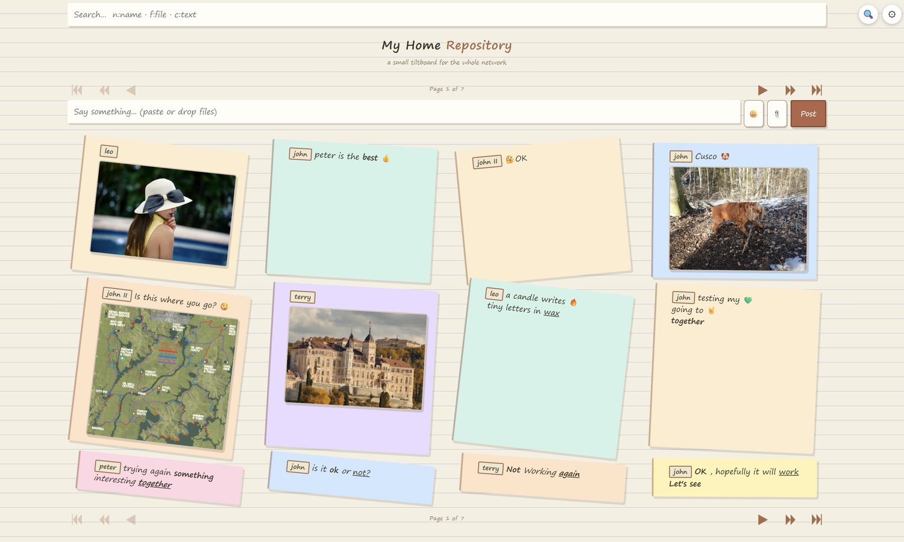
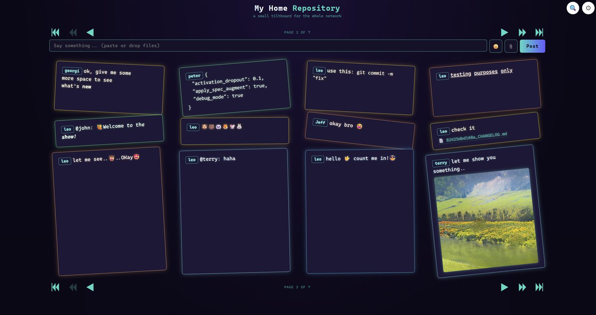

# Tiltboard

A tiny single-file web app (Python stdlib only, no dependencies). Type text in the box at the top and click **Post** — it appears as a tilted shape below the composer. Newest posts sit just under the text box; older ones stack toward the bottom of the page. Each card gets a random tilt angle and pastel color.

## Why Tiltboard exists

<p align="center"></p>
<p align="center"></p>

A file share, a chat and a bulletin board on one page - with none of the usual ceremony:

- **No login, no database** - open the page and post. Your *Name* badge, style and rows/columns live in browser cookies; new visitors set them once from the settings box.
- **Runs as a plain .exe** - `tiltboard.exe` needs nothing but Windows x64: double-click and it serves itself, reading config.json, chat.txt and styles/ right next to it.
- **The whole history is one text file** - every post is one line in `chat.txt`, human-readable, diff-able and portable; restart the server and everything comes back.
- **Share big files without thinking about it** - drag & drop or paste small ones straight onto the box; for anything over 256 MB attach with the paperclip and watch progress fill the text box while ~8 MB slices stream in the background.
- **Find any old post instantly** - the search bar filters *all* of chat.txt live as you type, including `u:name`, `f:filename` and plain-text queries.
- **Easy to make yours** - drop a `header.html` into the app folder for your own banner (logos, company name), pick one of seven built-in styles, or bring your own.

Posted texts persist to `chat.txt` (one line per tilt, newest last) and are restored on restart — the file grows without bound; the board simply pages through it in row-major chunks of *Rows* × *Columns* cards. Tilt angle and color are re-rolled randomly each time.

## Formatting

A small escape set works inside the message box; everything you type is stored literally (one line per tilt) and interpreted only when rendering, so it also survives restarts:

| You type                 | You get                                                                                             |
| ------------------------ | --------------------------------------------------------------------------------------------------- |
| `\n`                     | a new line inside the same tilt                                                                     |
| `\bword`                 | **bold** — formats the next non-space token (`\bbold rest of text`)                                 |
| `\uword`                 | <u>underlined</u> word (same rule: the very next token)                                             |
| `\iword`                 | *italic* word (same rule)                                                                           |
| stacked, e.g. `\b\itext` | all prefixes stack on that one word (**bold+italic**), in written order; `\b\btext` = single bold   |
| `` `snippet` ``          | **code** in backticks — literal text; only `\n` still breaks a line (format escapes ignored inside) |

Notes:
- **Name badge** - when *Name* in the settings box is not the default `User`, every post starts with `Name:`. On the board that prefix renders inside a small colored badge and the colon itself disappears; chat.txt still stores the plain `name: text` line, so nothing changes for readers of the file.
- A formatting escape applies to exactly one token — the run of characters up to the next space **or the start of another recognized escape**. `\bHello, world!` bolds only `Hello,`, and `\uwork\n\bsee` underlines `work` only, breaks the line, then bolds `see` (a chained escape is never swallowed into the previous word). Type each word separately if you want more.
  - A backslash that does not start a recognized escape stays literal inside its token: `\uLet'\\s` still underlines the whole `Let'\\s`; only a real `\\n`, `\\b`, `\\i` or `\\u` *inside* the word ends it and starts working. Plain text outside of a formatting escape is never affected — Windows paths such as `C:\new\file` keep every backslash.
- Pasted multi-line text arrives exactly as copied - all lines stay visible in the box (it grows to fit them), and on posting every line break becomes a `\n` escape, so chat.txt stays one line per tilt.
- Pasted `<b>…</b>` / `<i>…</i>` / `<u>…</u>` tag pairs are converted at paste time to stacked per-word prefixes (`<b>Hello world</b>` → `\bHello \bworld`, nested tags stack in written order). Tags you type by hand stay literal, as always.
- The box starts at exactly **one line of text** (with its icons) and grows dynamically whenever a new line appears - typed or pasted. After posting the page reloads and the box is back to its one-line size.
- **Enter posts the message, Shift+Enter inserts a new line** - handy for multi-line tilts without leaving the box.
- An escape with nothing after it (e.g. a trailing `\b`) and an unmatched backtick are shown literally, not treated as markup.
- All other characters render exactly as typed; anything HTML-like (`<script>`, quotes, …) is escaped automatically — the escapes above are the only way to influence rendering.

## Attachments

A post can carry **one file**: click the 📎 icon next to the emoji button, drag a file onto the box, or paste an image. The pending file appears as a paperclip inside the text box (top-right corner when it is multi-line) without changing its size. Hovering the clip shows the filename and makes it zoom up with a glow in the current theme's color; a small ✕ fades in beside it while hovering — clicking that removes the file before posting. Attaching a second file replaces the first.

On posting, images render as an inline preview inside the tilt (a download icon appears at its bottom-right corner on hover); any other file becomes a labeled download link. Files land in the data folder (`data_folder`), and `chat.txt` stores only the text plus an absolute link into that folder (a forward-slashed `file:///…` path, spaces %20-escaped) — so tilts keep working across restarts as long as the files stay where they were.

Uploads are routed by how they arrive: files **dragged onto the box or pasted** go out as one multipart request (that method proved reliable even for multi-GB drops — 4 GB verified), while anything attached through the 📎 paperclip always uses a chunked protocol — name reservation, ~8 MB slices streamed one after another, then commit, each step retried automatically. A drop larger than **256 MB** gets a hint to attach it via the paperclip instead of being sent directly.

While the paperclip path is uploading, progress renders *inside* the text box: a semi-transparent blue fill grows across it (typed text stays readable underneath) and a small label pill in its top-right corner shows `filename - x.x MB of y.y MB`, refreshing after every slice. The overlay tracks the box's real height, so even multi-line boxes never show progress spilling past their border.

## Search

The magnifier icon (left of the settings gear) toggles a search bar that live-filters **all** of chat.txt, not just the visible page. At least three characters activate it; matching tilts render exactly like normal posts and the pagers hide while filtering — closing the bar brings back your usual page view.

| You type            | It matches                                          |
| ------------------- | --------------------------------------------------- |
| `hello`             | any line containing *hello* (case-insensitive)      |
| `u:john` / `n:john` | only tilts posted by **john**                       |
| `f:my_pic.jpg`      | tilts whose attached file name contains it          |
| `c:text`            | message bodies only — the `name:` prefix is ignored |

Tokens separated by spaces are AND-ed, e.g. `u:john f:report.pdf` finds John's posts with a report.pdf attachment.

## Run

There are two ways to run the server. Both read **host and port from config.json only** - there is no command-line argument for them (change `"port"` in config.json instead).

### 1. Python script (development / any OS)

Python 3.10+ is all you need - the app uses only the standard library, so nothing to `pip install`:

```
python app.py            # serves http://localhost:8000 per config.json
```

### 2. Standalone Windows x64 executable (no Python on target PC)

Every GitHub Release (this one included) publishes a ready-to-run **tiltboard.exe** as a download asset - grab it from the Releases page and just run it:

```
tiltboard.exe            # same behaviour, finds its files next to itself
```

to rebuild it yourself you need one-time build tooling on any Windows x64 machine with Python installed:

```
pip install pyinstaller
python -m PyInstaller --onefile app.py    # writes dist\app.exe (rename it to tiltboard.exe)
```

The exe must live **next to** config.json, chat.txt and styles/ (that is where it looks for them); a `data` folder or your configured data_folder then works exactly as with the script. Both run modes share the same files - you can switch between them freely.

Then open `http://localhost:8000` in a browser — the UI is plain HTML/CSS/vanilla JS with no external libraries, so any modern evergreen browser works; verified fine on LM Studio's built-in app browser, Opera and Microsoft Edge. Stop with Ctrl+C (texts are kept in `chat.txt`). The app was developed and tested on Python 3.15; the minimum requirement stays 3.10.

Both run modes also write an application log to **tiltboard.log** next to the app (rotates at 1 MB, keeps 3 backups): startup info, each posted and deleted tilt as INFO lines, and every failed HTTP request (404 etc.) as a WARNING line.

## Configuration

`config.json` next to `app.py` (restart required after changes):

| Key           | Meaning                                                                                        | Fallback when missing or invalid |
| ------------- | ---------------------------------------------------------------------------------------------- | -------------------------------- |
| `host`        | bind address; `0.0.0.0` = reachable across the network                                         | `0.0.0.0`                        |
| `port`        | HTTP port                                                                                      | `8000`                           |
| `data_folder` | uploads + `chat.txt`; empty = auto-created `./data`, relative → from app dir, absolute → as-is | `<app>/data`                     |
| `style`       | theme name — any file in `styles/`; default when no visitor preference (cookie) exists         | `classic`                        |
| `rows`        | card **rows** filling one board page; 1–1000                                                   | `35`                             |
| `columns`     | cards **side by side** in each row; 1–100                                                      | `1`                              |

Out-of-range or non-numeric grid values fall back to the defaults (a warning is printed at startup). Pre-1.7.0 configs keep working: a legacy `max_tilts` key is read as `rows`.

**Windows paths.** A full path must double every backslash — `"D:\\Data\\Share\\"` — because a single `\D`, `\i`, … would be an invalid JSON escape and the file stops parsing. Forward slashes need no escaping at all (`"D:/Data/Share/"`) and work equally well; either form is fine.

**Per-user override.** The gear icon's settings box offers *Rows* and *Columns* next to *Name* and *Style*. Saved values go into the visitor's browser cookie (`tiltboard`) and beat the config file; new visitors start from the config defaults. Changing the grid reloads the page, re-paginates at that user's own page size (rows × columns), and lays cards out row-major — newest top-left, filling right along each row, oldest of the page bottom-right — with the arrow pair kept for stepping through older pages client-side (no full reload).

## Optional header (header.html)

An optional frame at the top of the page — repository name, logo, company info… — is read from a plain HTML fragment next to `app.py`, on every request:

1. `header.<style>.html` (e.g. `header.neon.html`) wins when present — per-theme override,
2. otherwise `header.html` — shared across all themes,
3. neither file → no header, the board renders exactly as before.

Editing the file needs only a **browser refresh** — it is re-read on each page load, no server restart. A ready-to-adapt template with usage comments ships as [header.example.html](header.example.html): copy it to `header.html`, change the `<h1>` text or drop in your own logo image. To make one file follow every theme's look, style with the CSS variables each stylesheet defines — `var(--tb-ink)` (text), `var(--tb-accent)`, `var(--tb-muted)` (faded) — instead of hard-coded colors; a per-style header file is only needed for a completely different layout, not just a different palette. The fragment may contain any HTML (``, links, its own `<style>` block with class names starting `tb-header`); no `<html>`/`<body>` wrapper.

## About this app

Tiltboard was created fully by an AI agent running in **LM Studio Bionic** — every line of `app.py`, all seven theme stylesheets and both documentation files were written by the agent; a human only requested features, tested them and approved releases.

- **Model:** `Qwen3.8-27B-Coder390-EfficientThink-Q4LynnStyle-MTP.gguf`, served by LM Studio's llama server with all layers on GPU (offload ratio 1). The earlier build (`...-Q4LynnStyle-Q8MTP.gguf`) was replaced because its responses were too slow.
- **Measured speed** (decode throughput from the November 2026 server logs, per-step `tg` samples): the Q8MTP build averaged a **median of ~14.5 t/s** (mean 34.3, unstable — half of all steps below 25 t/s) over ~328k tokens; the current MTP build holds a **stable median of ~57 t/s** (p25–p75: 43–72, peaks to 109) across ~950k tokens — roughly a 4× speedup that made long agent sessions practical.
- **Memory / KV cache:** ~40K context (40960) with flash attention and a unified, fully GPU-resident KV cache. The K cache is quantized to Q4_0 while the V cache stays at full precision — an asymmetric setup that keeps the big context affordable in VRAM without the slowdown of double-quantizing both tensors. MTP speculative decoding is enabled (draft tokens 0–3 per step). Initial settings were a Q8_0 K/V pair at 16K context; they were swapped for this configuration to fix slow response times.
- **Hardware:** NVIDIA GeForce RTX 4090, 24 GB VRAM (driver 621.01).
- **Timeline:** v1.0.0 started on 2026-11-05; the latest release is v1.16.0 of 2026-11-07 — 31 released versions across three days of interactive sessions (board grid and pagination, extended navigation, search bar, per-theme header frame, routed uploads with live progress), and development continues.
